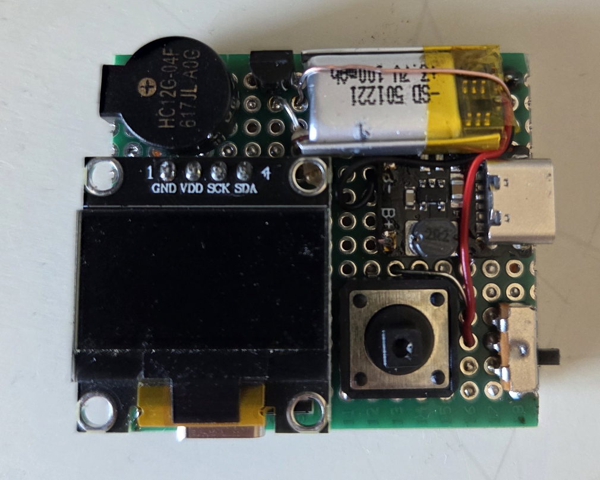
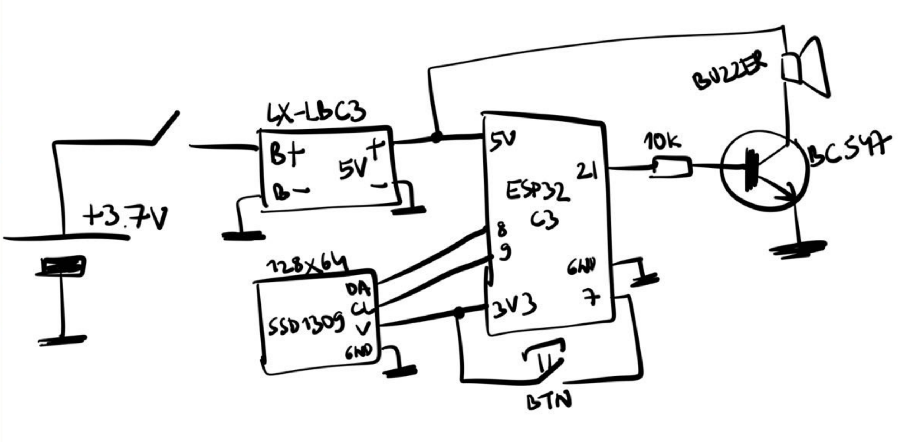

# Tic Tac Timer

A pocket-sized interval workout timer with a beeper, a 128x64 OLED and a single button. It also has a couple of games. It runs on an ESP32-C3 from a small Li-Po battery.



## What it is

I made this workout timer for myself. I found it more convenient to program the time intervals I need and get sound cues.

That purpose set the hardware: a monochrome 128x64 display, one button and a buzzer.

Later I found it interesting to build a screen-based architecture on top of it and vibe-code more useful or fun features. One button is not as limiting as it might seem.

### Why Tic Tac?

The first version fit in a Tic Tac box. It's now larger than a Tic Tac box and has no case, but the idea is the same.

## Features

- **Workout timer**: a 5-second countdown, then 24 s work / 10 s rest rounds until you stop it. It beeps at the start of every work and rest period, chirps at 1/3 and 2/3 of the work period, and counts down the last seconds of rest. The screen is inverted during rest so you can tell the two apart at a glance.
- **Flappy**: a one-button Flappy Bird–style game.
- **Click rush**: tap fast enough to keep the bar from draining.

## Controls

Everything is driven by one button. A press is classified when you release it:

| Press      | Duration    |
|------------|-------------|
| Short      | < 0.7 s     |
| Long       | 0.7 – 2 s   |
| Extra long | > 2 s       |

| Screen       | Short                     | Long          |
|--------------|---------------------------|---------------|
| Menu         | Next item                 | Open item     |
| Workout      | Pause / resume            | Back to menu  |
| Flappy       | Start, flap, restart      | Back to menu  |
| Click rush   | Start, click, retry       | Back to menu  |

The workout intervals are currently set at compile time: see the `ACTIVITY_*_DURATION` constants in [src/screens/WorkoutScreen.cpp](src/screens/WorkoutScreen.cpp).

## Hardware



| Part | Notes |
|------|-------|
| ESP32-C3 board | Any board exposing the pins below |
| 128x64 I2C OLED, SSD1306/SSD1309 | Driven with the Adafruit SSD1306 library, address `0x3C` |
| LX-LBC3 charger / boost module | Charges the battery over USB-C and outputs 5 V |
| 3.7 V Li-Po battery | |
| Buzzer | Switched by the transistor from 5 V |
| BC547 NPN transistor + 10 kΩ base resistor | Buzzer driver |
| Tactile button | |
| Slide switch | Power |

| ESP32-C3 pin | Connected to |
|--------------|--------------|
| GPIO 8 | OLED SDA |
| GPIO 9 | OLED SCL |
| GPIO 7 | Button (other leg to 3V3; uses the internal pull-down) |
| GPIO 21 | 10 kΩ → BC547 base (buzzer) |
| 5V | LX-LBC3 5 V output, buzzer + |
| 3V3 | OLED VCC, button |

## Building and flashing

### Prebuilt firmware

Every [release](https://github.com/TwoEightNine/TicTacTimer/releases) has a `tic_tac_timer.merged.bin` file. Flash it at offset `0x0`:

```bash
esptool.py --chip esp32c3 write_flash 0x0 tic_tac_timer.merged.bin
```

### From source

Requirements:

- [ESP32 Arduino core](https://github.com/espressif/arduino-esp32) by Espressif, 3.x (tested with 3.3.8)
- Libraries: **Adafruit SSD1306** (tested 2.5.16) and **Adafruit GFX Library** (tested 1.12.6), plus their dependency Adafruit BusIO

Arduino requires the sketch folder to have the same name as the `.ino` file, so clone into `tic_tac_timer`. If you download a ZIP, rename the extracted folder.

```bash
git clone https://github.com/TwoEightNine/TicTacTimer.git tic_tac_timer
```

**Arduino IDE:** open `tic_tac_timer/tic_tac_timer.ino`, select the **ESP32C3 Dev Module** board, then upload. Set **USB CDC On Boot: Enabled** if you want serial logs over the board's USB port.

**arduino-cli:**

```bash
arduino-cli core install esp32:esp32 --additional-urls https://espressif.github.io/arduino-esp32/package_esp32_index.json
```

```bash
arduino-cli lib install "Adafruit SSD1306" "Adafruit GFX Library"
```

```bash
arduino-cli compile --upload --port /dev/cu.usbmodem101 --fqbn esp32:esp32:esp32c3:CDCOnBoot=cdc tic_tac_timer
```

Replace the port with your own (`arduino-cli board list`).

## Project layout

```
tic_tac_timer.ino   setup() and loop(): wires hardware, screens and the navigator
src/core/           Screen base class and Navigator
src/hal/            Button and buzzer controllers
src/screens/        One file pair per screen (menu, workout, games, ...)
src/assets/         Bitmap frames (raw SSD1306 buffers) + Animations.h
```

See [ARCHITECTURE.md](ARCHITECTURE.md) for how screens, navigation, input and sound fit together, and the conventions for adding a new screen.

## License

Tic Tac Timer is free software: you can redistribute it and/or modify it under the terms of the GNU General Public License as published by the Free Software Foundation, either version 3 of the License, or (at your option) any later version. See [LICENSE](LICENSE).
